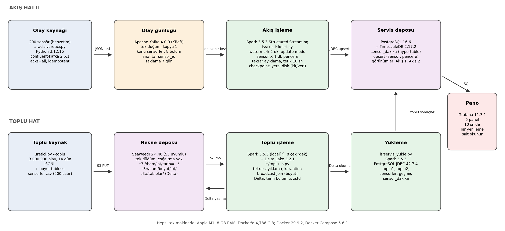

# 3. Mimari (Z0)

Sürümler çalışan kapsayıcılardan okundu: `kafka-topics.sh --version`, `spark-submit --version`, `weed version`, `SELECT version()`, Grafana `/api/health` ve Python paket sürümleri. Şekil `analiz/mimari_sekli.py` ile çiziliyor.

**Şekil 3.1.** Omurga şeması. Üstte akış hattı, altta toplu hat. İki hat aynı servis deposunda birleşiyor. Grafana yalnızca servis deposunu okuyor.

İki hattın görevi farklı. Akış hattı son dakikaları en geç 30 sn içinde panoya getiriyor (Akış 1 ve Akış 2). Toplu hat 14 günlük geçmişten desen çıkarıyor (Toplu 1 ve Toplu 2). Ortak noktaları iki tane. Biri aynı veri sözlüğü (Ek B): sensörün olayı iki hatta da aynı alanlarla geliyor. Diğeri aynı servis deposu: Grafana iki hattın sonucunu aynı yerden okuyor.

## 3.1 Bileşenler ve seçim gerekçesi

**Tablo 3.1.** Bileşenler.

| Katman | Bileşen (sürüm) | Neden bu | Ayrıntı |
|---|---|---|---|
| Olay kaynağı | `araclar/uretici.py`, Python 3.12.16, confluent-kafka 2.6.1 | Kitin üreticisi; grup koduna göre aynı veriyi üretiyor | Bölüm 4 |
| Olay günlüğü | Apache Kafka 4.0.0 (KRaft) | Olayları sırayla saklıyor, tüketici kaldığı yerden okuyabiliyor | Bölüm 8.1 |
| Ham depolama | SeaweedFS 4.48 (S3 uyumlu) | Kitte hazır; S3 arayüzü gerçek bulut deposuyla aynı | Bölüm 5 |
| Toplu işleme | Spark 3.5.3 + Delta Lake 3.2.1 | Delta'da yazma ya tamamen görünür ya hiç (deneyle gösterildi) | Bölüm 5, 7 |
| Akış işleme | Spark 3.5.3 Structured Streaming | Olay zamanı, watermark ve checkpoint hazır; toplu işle aynı kütüphane | Bölüm 8 |
| Servis deposu | PostgreSQL 16.6 + TimescaleDB 2.17.2 | Zaman aralığı sorguları, upsert, SQL ile join; ölçülen p99 en fazla 11,3 ms | Bölüm 9 |
| Pano | Grafana 11.3.1 | PostgreSQL kaynağı hazır, pano dosyadan kuruluyor | Bölüm 9.5 |

## 3.2 Garanti tablosu

Her ok için üç şey var: kaç kopya (bizde / üretimde), sıra garantisi, bağlantı koparsa ne olduğu. "Ölçüldü" yazan hücreler deneye dayanıyor; kanıt dosyası parantez içinde (`kanit/` altında).

**Tablo 3.2.** Okların teslim, sıra ve bölünme davranışı.

| Ok | Kaç kopya (bizde → üretimde) | Sıra garantisi | Ağ bölünürse / karşı taraf düşerse |
|---|---|---|---|
| Sensör → üretici | 1 → 1 (sensörde tek kopya; cihaz yerel tampon tutmalı) | Olaylar üretim sırasıyla gönderiliyor ama %5'i 2 dk'ya kadar geç geliyor. Yani olay zamanı sırası zaten yok; Spark olay zamanına göre çalışıyor | Bizde üretici ile sensör aynı süreç. Gerçekte sensörün ağı koparsa cihaz olayları tamponlar, tampon dolarsa olay kaybolur. Bu kayıp Toplu 2'nin "veri kaybı" sorusunda görünür |
| Üretici → Kafka | 1 → 3 (`replication.factor` 1 → 3, `min.insync.replicas=2`) | `acks=all` + idempotent üretici: aynı bölümde (aynı `sensor_id`) sıra korunuyor, yeniden denemede kopya oluşmuyor | **Ölçüldü:** Kafka 90 sn durunca üretici `Connection refused` hatası bastı, olayları bellekte tuttu ve Kafka gelince gönderdi. Gönderilen 29.304 olayın hepsi Kafka'da (`kirilma-deneyi-kafka.txt`). Tamponun bir sınırı var; daha uzun kesintide üretici olay atar |
| Kafka → Spark akış | 1 → 3 | Bölüm içinde ofset sırası. Pencereler olay zamanına göre kuruluyor, varış sırası önemli değil | **Ölçüldü:** Kafka 60 sn'den uzun kapalı kalırsa akış işi `TimeoutException` ile ölüyor ve kendiliğinden dönmüyor. Aynı checkpoint ile başlatınca 24.577 olayı yakaladı, kayıp 0 (`kirilma-deneyi-kafka-kurtarma.txt`). Teslim: en az bir kez |
| Spark akış → checkpoint | 1 → 3 (yerel disk → kalıcı, kopyalı disk ya da HDFS) | Yığın numarasına göre sıralı günlük (ofset ve durum) | **Ölçüldü:** Checkpoint kaybolunca iş `earliest` ile başlatılırsa baştan okuyor, kayıp 0. `latest` ile başlatılırsa 2.289 mesaj atlanıyor, kayıp %21,9 (`kirilma-deneyi-checkpoint-*.txt`) |
| Spark akış → servis deposu | 1 → 2 (birincil + eşzamanlı yedek) | Sıra gerekmiyor: anahtar (sensör, pencere); her yazım o pencerenin o ana kadarki toplamı | **Ölçüldü:** Veritabanı durunca yığın hata verdi, iş öldü. Ofset ilerlemediği için yeniden başlatınca kayıp 0, tekrar 0 (`kirilma-deneyi-db.txt`). Çökmede aynı yığın iki kez yazılıyor, upsert sayesinde sonuç tam bir kez (`akis-cokme-deneyi.txt`) |
| Üretici (toplu) → S3 ham | 1 → 3 (ya da silme kodlu depolama) | Sıra yok, dosya bazında; her gün ayrı klasör | S3 düşerse yazma hata veriyor, üretici yeniden çalıştırılır |
| S3 ham → Spark toplu → S3 Delta | 1 → 3 | Sıra yok; Delta işlem günlüğünde sürümler sıralı | **Ölçüldü:** Yazma sırasında iş öldürülünce Delta eski sürümü eksiksiz okuyor, çıplak Parquet ise okunamıyor (`atomik-yazma-deneyi.txt`). `--tarih` ile bir günü yeniden işlemek yalnızca o günü değiştiriyor |
| Delta → servis deposu (`servis_yukle.py`) | 1 → 2 | Sıra yok | Tablo önce boşaltılıp (`TRUNCATE`) sonra dolduruluyor; ikisi tek bir işlem değil. Yükleme yarıda kalırsa tablo yarım kalır, panoda toplu paneller eksik görünür; iş yeniden çalıştırılınca düzelir. Üretimde yeni tabloya yazıp adını tek işlemde değiştirmek gerekir |
| Servis deposu → Grafana | 1 → 1 (Grafana durumsuz, birden çok kopya çalışabilir) | — | **Ölçüldü:** Veritabanı kapalıyken panel sorgusu `db query error: failed to connect to server` ile 500 döndü; Grafana'nın kendisi ayaktaydı. Pano "susan sensör yok" demiyor, hata gösteriyor (`kirilma-deneyi-db.txt`) |

## 3.3 Kitin sadeleştirmeleri ve üretimde ne olmalı

**Tablo 3.3.** Tek makine sadeleştirmeleri ve üretimdeki karşılıkları.

| Bu kurulumda | Neden sorun | Üretimde |
|---|---|---|
| Kafka tek düğüm, `replication.factor=1` | Düğüm ölürse saklanan olaylar gider. Ölçtüğümüz 90 sn'lik kesintide yazma ve okuma tamamen durdu | En az 3 broker, `replication.factor=3`, `min.insync.replicas=2`. Bir broker düşse de yazma sürer |
| SeaweedFS tek düğüm, çoğaltma yok | Disk bozulursa ham veri ve Delta tabloları gider | Çoğaltmalı ya da silme kodlu nesne deposu, ayrı bölgede yedek |
| Spark `local[*]`, sürücü belleği 1 GB, işler aynı kapsayıcıda | Toplu iş ile akış işi aynı 8 çekirdeği paylaşıyor. **Ölçüldü:** toplu iş sürerken akış yığınları ortalama 3,0 sn'den 13,8 sn'ye, en uzunu 36,5 sn'ye çıktı; uyarı sınırı aşılıyor (`kirilma-deneyi-bellek-3.txt`) | Ayrı yürütücülerle küme (Kubernetes ya da YARN); akış işine ayrılmış kaynak |
| Akış checkpoint'i yerel diskte (`kit/veri/checkpoint`) | Bizim seçimimiz. S3'te yığın başına ~10 sn sürüyordu ve uyarı gecikmesi 30 sn'yi aşıyordu (bölüm 8.3). Disk giderse iş baştan başlar | Sürücünün kalıcı ve kopyalı diski ya da HDFS |
| Güvenlik kapalı: TLS yok, S3 anahtarı ve veritabanı şifresi düz metin | Ağdaki herkes okuyup yazabilir | TLS, kimlik doğrulama (Kafka SASL, S3 erişim politikası), şifreler ayrı bir kasada |
| Grafana anonim giriş (salt okunur), yönetici şifresi compose dosyasında | Panoyu ağdaki herkes görür | Kurumsal oturum açma, rol bazlı yetki |
| TimescaleDB tek düğüm, yedek yok | Düşerse akış işi ölüyor ve pano hata veriyor (ölçüldü) | Eşzamanlı yedekli PostgreSQL ve otomatik yük devri; akış işinde yeniden deneme |
| Akış işi elle başlatılıyor | Kafka ya da veritabanı kesintisinde iş ölüyor ve kendiliğinden dönmüyor (ölçüldü) | Gözetmen altında çalışma (ör. Kubernetes ya da `restart: on-failure`), iş ölünce uyarı |
| Üretici tek Python süreci, bu makinede en fazla ~7.780 olay/sn | Sensör ağının benzetimi; gerçek ağ kopmaları ve saat kaymaları çok daha karmaşık | Binlerce bağımsız cihaz, cihazda tampon ve saat eşitleme |
| Hepsi tek makinede, Docker'a 4,786 GiB | **Ölçüldü:** iki Spark işi aynı anda çalışırken bütün kapsayıcılar toplam 3,89–4,02 GiB'a çıktı (üç koşu), sınıra 0,8 GiB kaldı | Bileşenler ayrı makinelerde, ayrı kaynak sınırlarıyla |

Kitin altyapısında değiştirdiklerimiz README'deki "Kitten farklar" tablosunda: S3 sağlık denetimi (`127.0.0.1`), `matplotlib`, `servis-ts` profili (TimescaleDB ve Grafana), PostgreSQL JDBC paketi.
