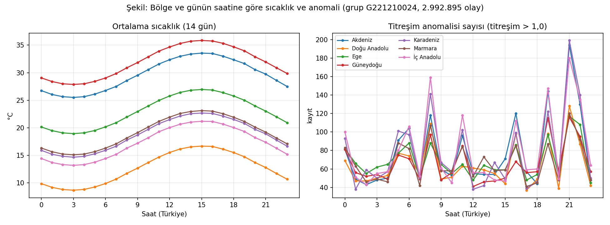
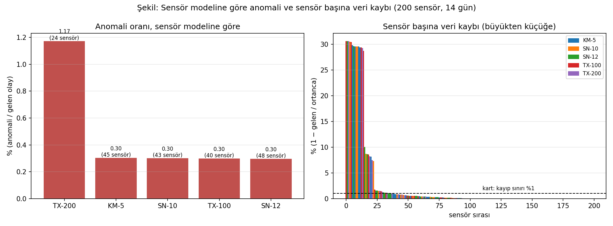

# 7. Toplu hat (Z5)

Kod: `is/toplu_is.py`. Çalıştırma: `docker compose exec spark spark-submit is/toplu_is.py`. Bir günü yeniden işlemek için `--tarih YYYY-MM-DD` eklenir. Veri: 3.000.000 satır, 14 gün. Ölçüm ortamı: Apple M1, 8 GB RAM, Docker'a 4.786 GiB, Spark 3.5.3 `local[*]` (8 çekirdek), sürücü belleği 1 GB.

## 7.1 Hat

```
s3a://ham/iot/tarih=*/      ──oku (şema elle)──▶ tarih, saat_tr sütunları
                            ──tekrar ayıkla (bütün alanlar)──▶ 5.905 satır atıldı
                            ──sensor_id yok──▶ s3a://tablolar/iot_karantina (1.200 kayıt)
s3a://ham/boyut/iot/sensorler.csv ──broadcast join (sensor_id)──▶ bolge boşsa doldur (1.169), model, kurulum_yili
                            ──anomali = titresim > 1,0──▶ s3a://tablolar/iot (Delta, tarih bölümlü, 2.992.895 satır)
s3a://tablolar/iot          ──groupBy(bolge, saat_tr)──▶ s3a://tablolar/iot_toplu1   (Toplu 1)
                            ──groupBy(sensor_id) + join──▶ s3a://tablolar/iot_toplu2 (Toplu 2)
```

Map, shuffle ve reduce karşılıkları:
- Map: JSON okuma, zaman sütunlarının çıkarılması, `sensor_id` filtresi, broadcast join ve `anomali` sütunu. Bunlar her satırda ayrı ayrı yapılıyor ve veri taşımıyor.
- Shuffle: Tekrar ayıklama (aynı satırların aynı göreve gelmesi gerekiyor), `groupBy(bolge, saat_tr)`, `groupBy(sensor_id)` ve sonuç sıralaması.
- Reduce: Shuffle sonrası her gruptaki son toplama (count, avg, percentile).

Neden böyle?
- Şema elle veriliyor. Kitin iskeleti şemayı veriden çıkarıyordu; bu, bütün JSON'u bir kez fazladan okumak demek. İskeletin "ham satır" adımı 7,6 s sürdü (`kanit/iskelet-ilk-kosu.txt`).
- Boyut tablosu 200 satır (6.421 bayt), bu yüzden broadcast join kullanıyoruz (bkz. 7.4).
- Tarih sütunu olay zamanından türetiliyor, klasör adından değil. Böylece tablonun günleri olayın gerçek gününe göre bölünüyor.

## 7.2 Fiziksel plan (`kanit/explain-1.txt`)

`explain(mode="formatted")` çıktısı üç plan içeriyor: Toplu 1, Toplu 2 ve temizleme hattı. Bu dosya `--tarih 2026-11-16` koşusundan alındı, bu yüzden temizleme hattında o güne ait klasör budaması da görünüyor.

### Toplu 1: `groupBy(bolge, saat_tr)`

```
Scan parquet (Delta) → Project → ObjectHashAggregate (kısmi) → Exchange hashpartitioning(bolge, saat_tr, 8)
→ ObjectHashAggregate (son) → Exchange rangepartitioning(bolge, saat_tr, 8) → Sort
```
- `ReadSchema: struct<bolge, sicaklik, titresim, saat_tr, anomali>`: Tablodaki 12 sütundan yalnızca 5'i okunuyor (projection pushdown).
- Birinci Exchange: Aynı (bölge, saat) grubundaki satırlar farklı görevlerde. Son toplamı yapabilmek için hepsinin aynı bölüme gelmesi gerekiyor. Spark bunu azaltmak için önce her görevde kısmi toplama yapıyor, sonra yalnızca 168 grubun ara sonuçlarını taşıyor.
- `ObjectHashAggregate`: `percentile_approx` her grup için bir özet nesnesi tuttuğu için normal `HashAggregate` yerine bu kullanılıyor.
- İkinci Exchange (`rangepartitioning`): Sonucun `orderBy(bolge, saat_tr)` ile sıralanması için. Sonuç yalnızca 168 satır olduğu için ucuz.

### Toplu 2: sensör başına sayım ve boyut tablosu

```
Scan parquet (Delta) → HashAggregate (kısmi) → Exchange hashpartitioning(sensor_id, 8) → HashAggregate (son)
Scan csv (sensorler.csv) → Filter → BroadcastExchange
→ BroadcastHashJoin LeftOuter BuildRight
```
- `ReadSchema: struct<sensor_id, anomali>`: 12 sütundan yalnızca 2'si okunuyor.
- Exchange: Sensör başına sayım için, aynı sensörün satırları bir araya geliyor.
- Join stratejisi: `BroadcastHashJoin`, `BuildRight`. Boyut tablosu (sağ taraf) bütün görevlere kopyalanıyor, büyük taraf yerinde kalıyor. Join, toplamadan sonra 200 satırla yapılıyor.
- Boyut tablosu taramasında `PushedFilters: [IsNotNull(sensor_id)]`: Spark, join anahtarı boş olan satırları okurken eliyor.

### Temizleme hattı

```
Scan json → Filter → Project → HashAggregate (kısmi) → Exchange hashpartitioning(olay_zamani, sensor_id, bolge, titresim, nem, sicaklik, 8)
→ HashAggregate (son) → BroadcastHashJoin LeftOuter BuildRight ← BroadcastExchange ← Scan csv
```
- `PartitionFilters: [isnotnull(tarih), (tarih = 2026-11-16)]`: `--tarih` filtresi klasör düzeyinde uygulanıyor, 14 klasörden yalnızca biri okunuyor.
- `PushedFilters: [IsNotNull(sensor_id)]`: Kodda `sensor_id` filtresi tekrar ayıklamadan SONRA yazılı. Spark bunu taramaya kadar indirmiş, çünkü `sensor_id` tekrar ayıklamanın anahtarlarından biri ve filtre sonucu değiştirmiyor. Böylece karantinaya gidecek satırlar shuffle'a girmiyor. (Karantina tablosu için Spark ayrı bir plan çalıştırıyor.)
- Exchange: `dropDuplicates` bütün alanlar üzerinden yapıldığı için hash bütün alanlardan hesaplanıyor. Bu, hattaki tek büyük shuffle. Spark UI'da ilk aşama 410,7 MiB okuyup 98,0 MiB shuffle yazıyor (`kanit/spark-ui-2.png`).

## 7.3 Spark UI (`kanit/spark-ui-1.png`, `kanit/spark-ui-2.png`)

Ekran görüntüleri `analiz/olcum_performans.py` çalışırken (temizleme hattı, 8 koşu) alındı.
- `spark-ui-1.png` (Jobs): Her koşu üç işten oluşuyor: boyut tablosunun okunması (1 görev), JSON taraması ve tekrar ayıklamanın ilk yarısı (14 görev, her JSON dosyası bir görev) ve shuffle sonrası (8 görev, `shuffle.partitions = 8`). Sort-merge koşularında ikinci bir shuffle aşaması da var (31 görev).
- `spark-ui-2.png` (aşama 24, sort-merge koşusunun JSON taraması): 14 görev 8 çekirdeğe iki dalga halinde dağılmış. İlk 8 görev 6–9 s, ikinci dalgadaki 6 görev 4 s sürmüş (ortanca 7 s, en çok 9 s). Görevlerin girdisi eşit (her biri 29,3 MiB, yaklaşık 214.240 kayıt); süre farkını veri çarpıklığı değil, ilk dalgadaki 8 görevin aynı anda çekirdek ve belleği paylaşması yaratıyor. GC süresi görev başına 0,1–0,5 s.

Bundan çıkan sonuç: 14 dosya 8 çekirdeğe tam bölünmüyor, son dalgada 2 çekirdek boş kalıyor. Gün başına 1 dosya yerine 8'in katı sayıda eşit dosya olsaydı ikinci dalga dolu çalışırdı. Bu bir gözlem; ölçmedik.

## 7.4 Performans kararı: boyut tablosu join'i broadcast olsun

Aynı veri, aynı temizleme hattı. Çıktı `noop` biçimine yazıldı (plan tamamen çalışıyor ama dosya yazılmıyor). İki ayrı çalıştırmada, her durum 1 ısınma + 3 ve 1 ısınma + 5 koşu (`z5_perf_*` satırları):

| Durum | Join | 3 koşu ort. | 5 koşu ort. | 8 koşunun ortalaması | 8 koşunun ortancası |
|---|---|---|---|---|---|
| Broadcast, `shuffle.partitions=8` | BroadcastHashJoin | 8,133 s | 9,025 s | 8,69 s | 9,02 s |
| Sort-merge (`autoBroadcastJoinThreshold=-1`), `shuffle.partitions=8` | SortMergeJoin | 10,781 s | 12,667 s | 11,96 s | 11,05 s |
| Broadcast, `shuffle.partitions=200` | BroadcastHashJoin | 8,116 s | 10,250 s | 9,45 s | 10,01 s |

(Koşular: broadcast 8,300 / 10,139 / 5,959 / 9,647 / 8,782 / 9,263 / 9,659 / 7,777; sort-merge 14,805 / 8,524 / 9,013 / 10,649 / 8,319 / 11,459 / 18,002 / 14,905; 200 bölüm 9,703 / 7,041 / 7,605 / 10,312 / 10,917 / 10,318 / 8,708 / 10,996 s.)

Sonuç: Broadcast join 8 koşunun ortalamasında sort-merge'den 3,27 s (%27) daha hızlı. İki ayrı çalıştırmada da broadcast önde. Koşular arasındaki dalgalanma büyük (sort-merge 8,3 ile 18,0 s arasında), ama iki durumun ortancaları arasındaki fark (9,02 s'ye karşı 11,05 s) da aynı yönde.

Neden işe yarıyor? Sort-merge join'de iki taraf da `sensor_id`'ye göre yeniden bölümleniyor ve sıralanıyor. Yani tekrar ayıklamadan çıkan 2,99 milyon satır ikinci kez shuffle ediliyor. Spark UI'da sort-merge koşularındaki 31 görevlik ek aşama bu. Broadcast join'de yalnızca 200 satırlık boyut tablosu her göreve kopyalanıyor, büyük taraf yerinden kıpırdamıyor. `is/toplu_is.py` içinde join'i `F.broadcast(...)` ile açıkça işaretledik. Böylece Spark'ın otomatik eşiği (10 MB) değişse de karar sabit kalıyor.

`shuffle.partitions` 8 mi 200 mü? Kitin `spark-defaults.conf` dosyası bunu zaten 8 yapıyor. 200 ile ilk çalıştırmada fark yoktu (8,116 s'ye karşı 8,133 s), ikincisinde 200 daha yavaştı (10,250 s'ye karşı 9,025 s). Spark 3.5'te açık olan AQE, shuffle sonrası küçük bölümleri kendiliğinden birleştirdiği için fark beklenenden küçük. Bu ölçümle "8 daha iyi" diyemiyoruz; yalnızca 200'e çıkmanın bir şey kazandırmadığını söyleyebiliriz.

## 7.5 Sonuçlar ve grafikler

Toplu iş 75,1 s'de bitti (Delta tablosunun ilk yazıldığı koşu 112,7 s sürdü). Grafikler `analiz/grafikler.py` ile çizildi (`analiz/cikti/toplu1.png`, `toplu2.png`).

### Toplu 1: Bölge ve günün saatine göre sıcaklık ve anomali



Bulgu: Bütün bölgelerde sıcaklık en düşük saat 03.00'te (bölgeler ortalaması 17,71 °C), en yüksek saat 15.00'te (25,71 °C). Bölgeler arasındaki fark gün içindeki farktan büyük: Doğu Anadolu ortalama 12,70 °C, Güneydoğu 31,87 °C. Titreşim anomalileri ise bölgeden bağımsız olarak aynı saatlerde yığılıyor. En çok anomali 21.00'de (1.054 kayıt; saat başına ortanca 384), bu saat bütün bölgelerde ilk sırada.

### Toplu 2: Sensör modeline göre anomali, sensör başına veri kaybı



Bulgu: TX-200 modelinin anomali oranı %1,17. Bu, diğer dört modelin (%0,295–%0,302) yaklaşık 4 katı. Veri kaybı ise modelle değil sensörle ilgili. Kaybı %20'yi aşan 15 sensörün hepsi 13'ün katı (sensor-013, -026, … -195; kayıp %28,7–%30,6). %5–%20 arasındaki 8 sensörün hepsi 23'ün katı (sensor-023, -046, … -184; %7,3–%10,1). Bu sensörler beş modele de dağılmış durumda.

Nasıl ölçtük? Beklenen olay sayısı, 200 sensörün 14 gündeki olay sayısının ortancası (15.338). Rastgele dalgalanma bu sayının karekökü kadar, 124 olay (%0,81). Bu yüzden kaybı %1–%5 arasında çıkan 14 sensörü gerçek kayıp saymıyoruz; kartın %1 sınırı bu ölçümün dalgalanmasına çok yakın.
